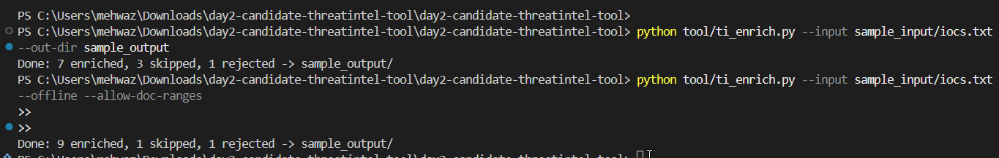
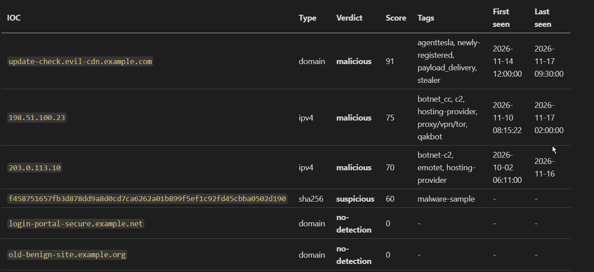

# Candidate: Ifrah Hasware | Track: Security Research | Day 2 | Date: 18 Nov 2026 | Time spent: 4 hrs

## 1. Tool Objective
`ti_enrich.py` takes an IOC list (IPs, domains, hashes), check against each from public threat feeds, scores it, and emits a structured intel brief (Markdown + JSON). It lets an analyst triage a raw IOC list in seconds instead of checking each indicator by hand.

## 2. Scope & Environment
Public datasets/APIs plus **synthetic** sample data (RFC 5737 documentation IPs, reserved `.example` domains, hashes of dummy strings). Self-owned laptop only. Nothing was organizer-provided.

## 3. Tool Design
- **Inputs:** text file of IOCs (defanged forms accepted), optional flags.
- **Outputs:** `intel_brief.md`, `intel_brief.json`.
- **Flow:** parse + refang + dedupe -> scope guard -> load feeds once (Feodo, ThreatFox, MalwareBazaar) -> per-IOC enrichment (feed hits, ip-api geo/ASN, RDAP domain age) -> score/verdict -> brief.
- **Rate limits/errors:** per-host throttling, `Retry-After`/`X-Rl` handling, exponential backoff, graceful per-feed failure, exit code 2 if every feed fails.
- **Safety:** passive lookups only; private/reserved IPs skipped; no secrets or PII.
- **Dependencies:** none beyond the Python standard library.

## 4. How to Run
```bash
python tool/ti_enrich.py --input sample_input/iocs.txt --out-dir sample_output            # live
python tool/ti_enrich.py --input sample_input/iocs.txt --offline --allow-doc-ranges       # offline demo
```
Sample input: `sample_input/iocs.txt` (12 lines: 3 IPs of interest, 1 benign IP, 1 private IP, 2 domains, 1 defanged URL, 3 hashes, 1 duplicate, 1 invalid).

## 5. Evidence Summary
- Run command: 
- Output brief: 
- Text run log: [evidence/run_log.txt](evidence/run_log.txt)
- Committed outputs: [intel_brief.md](sample_output/intel_brief.md), [intel_brief.json](sample_output/intel_brief.json)

## 6. Results
On the sample list the tool produced 9 enriched IOCs: 3 malicious (a young ThreatFox-listed domain scoring 91, a ThreatFox C2 IP at 75, a Feodo C2 IP at 70), 1 suspicious SHA256 (MalwareBazaar hit), 5 no-detection. It skipped `10.0.0.5` (scope guard), rejected `not_an_ioc!!`, and merged the duplicate. Source Status reports each feed's health.

## 7. Limitations / Next Step
Feeds cover recent windows only, so "no detection" is not proof of safety; MD5/SHA1 are not checked. **Day 3:** add an optional VirusTotal/OTX module via env-var key, cache results on disk, and map malware families to MITRE ATT&CK.

## 8. References / Sources
See [sources/links.md](sources/links.md).

## 9. Self-Attestation
I self-sourced all materials, used only public/synthetic/self-owned resources, built a working tool, and performed non-destructive work.
